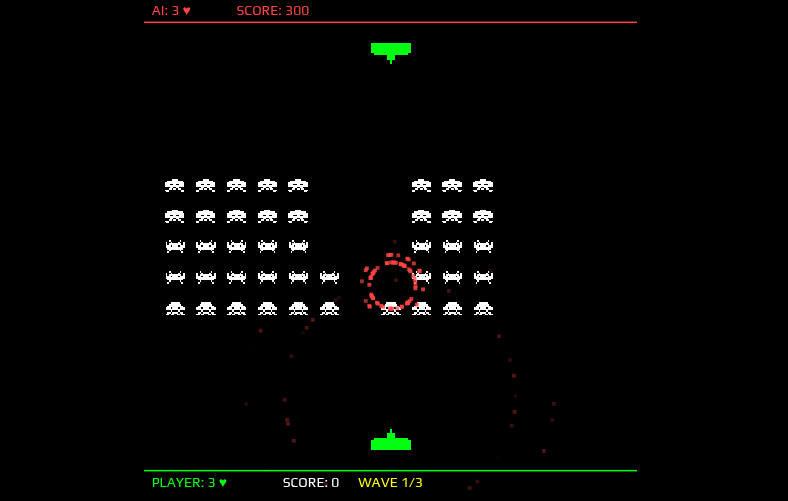

# 👾 Space Invaders

[Space Invaders](https://en.wikipedia.org/wiki/Space_Invaders) game in single (~4KB Gzipped) JavaScript file!

[Play Online](https://pi0.github.io/space-invaders/)

## Two-Player Mode (vs AI)

Battle against an AI opponent! Both players compete to destroy aliens and earn points.



**Features:**
- 🎮 Human player (green) at the bottom, AI player (red) at the top
- 👾 Aliens spawn in the middle - both players shoot to destroy them
- 💥 Players can hit each other directly
- 🏆 3 waves of aliens - highest score wins!
- 📱 Touch controls supported for mobile

**Controls:**
- ← → Arrow keys to move
- SPACE to shoot
- ENTER to start

## Using in your pages

Checkout [`index.html`](./index.html) for additional styles.

```html
<div id="game"></div>
<script type="module">
const { startGame } = await import("https://cdn.jsdelivr.net/gh/pi0/space-invaders/index.js");
startGame({ selector: "#game" });
</script>
```

## License

MIT - Pooya Parsa <pooya@pi0.io>

Based on [a codepen](https://codepen.io/adelciotto/pen/WNzRYy) by Anthony Del Ciotto ([@adelciotto](https://github.com/adelciotto))
